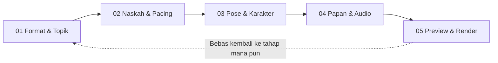

# Product Requirement Document (PRD): Redesain Stickman Studio (Whiteboard & Sketch Animation)

**Versi Dokumen:** 1.0  
**Tanggal:** 28 September 2026  
**Target Rute:** `http://localhost:5173/stickman-studio`  
**Format Video:** Dual-Format (16:9 Landscape YouTube & 9:16 Vertical Shorts/TikTok)  
**Referensi Alur:** `http://localhost:5173/shorts-studio` (Wizard Stepper Flow)  
**Status:** Ready for Review / Implementation Plan  

---

## 1. Latar Belakang & Tujuan Redesain

**Stickman Studio** adalah modul animasi edukasi & storytelling beraliran *hand-drawn whiteboard*, *chalkboard*, dan *sketchbook journal* (gaya Dan Koe / Casually Explained). Format ini terbukti memiliki retensi sangat tinggi di YouTube karena visualnya dinamis, ekspresif, dan tidak membosankan.

Fitur Stickman Studio saat ini sangat kaya, meliputi:
- Ratusan pose stickman, doodle rumus, dan ilustrasi grafik.
- 6 pilihan tema kertas/latar (Whiteboard, Moleskine Sketchbook, Kraft Paper, Grid Journal, Doodle Formulas, Chalkboard Hitam).
- Tipografi kapur tulis (*Chalk Sketch Fonts*) dengan warna dua tingkat (*dual-color headline*).
- Efek gerak *Sketch Shake* (getar tangan sketsa) & variasi animasi masuk (*Pop, Slide, Zoom, Drop*).
- AI Scriptwriter & Script Humanizer (gaya santai dan jeda dramatis).
- Generator judul berbasis CTR.
- Pilihan suara multi-bahasa (Indonesia & Inggris) + Filter Vokal FFmpeg DSP.

**Masalah Saat Ini:**
Halaman `/stickman-studio` saat ini memuat seluruh pengaturan (ribuan baris kode Svelte) dalam satu layar dashboard yang sangat padat. Pengguna harus mengatur tema kertas, font, animasi getar, naskah, kategori stiker, suara, dan player di dalam layout bertumpuk yang memicu kebingungan urutan pengerjaan (*overloaded interface*).

**Tujuan Redesain:**
Menerapkan alur berpanduan **5 Tahap (Stepper Wizard Flow)** yang modular, teratur, dan elegan seperti pada `/shorts-studio`, dengan **100% fitur eksisting tetap utuh** serta fleksibilitas memilih format **16:9 Landscape** atau **9:16 Shorts** kapan saja.

---

## 2. Prinsip Utama Desain (Design Principles)

1. **Zero Feature Loss (Tanpa Pengurangan Fitur):**
   Seluruh kemampuan animasi stickman (6 tema kertas, safe area padding 0-6%, preset font kapur, layout side kiri/kanan/tengah, script humanizer, filter vokal, BGM, dan render FFmpeg) tetap dipertahankan secara utuh.
2. **Step-by-Step Clarity:**
   Membagi pengerjaan menjadi 5 langkah logis: Ide & Format ➔ Naskah & Pacing ➔ Karakter & Papan Sketsa ➔ Audio & Tipografi ➔ Live Player & Render.
3. **Seamless Dual Aspect Ratio (16:9 & 9:16):**
   Pengguna dapat berpindah antara format horizontal (YouTube Long) dan vertikal (Shorts/TikTok) tanpa merusak komposisi adegan.
4. **Interactive Creative Freedom:**
   Tiap langkah memberikan preview instan terhadap perubahan tema kertas, font, pose karakter, dan suara narator.

---

## 3. Matriks Komparasi Workflow

| Aspek | Stickman Studio Saat Ini | Stickman Studio Baru (Stepper Flow) |
| :--- | :--- | :--- |
| **Navigasi Antarmuka** | Single scroll view yang sangat panjang dan padat. | Top Stepper Bar 5 Tahap dengan indikator progres visual. |
| **Pemilihan Format** | Tombol toggle terisolasi di pojok header. | Terintegrasi rapi di Step 1 (Setup Format & Ide). |
| **Kurasi Pose & Karakter** | Panel stiker bercampur dengan timeline dan audio. | Tahap khusus (Step 3) dengan gallery pose & filter kategori. |
| **Gaya Papan Tulis & Tipografi** | Pengaturan font, kertas, dan warna tersebar. | Dikelompokkan rapi di Step 4 (Tema Kertas, Font Kapur & Audio). |
| **Review & Render** | Player dan tombol render berhimpitan di sisi kanan. | Step 5 difokuskan sebagai Canvas Theatre & Render Hub. |

---

## 4. Alur Kerja Baru 5 Langkah (The 5-Step Architecture)



---

### Step 01: Format, Niche & Ide Judul (`01 Format & Topik`)
*Fokus: Memilih aspek rasio, kategori konten, dan meriset judul video dengan CTR tinggi.*

* **Fitur yang Dipertahankan & Ditingkatkan:**
  1. **Pemilihan Aspek Rasio (Aspect Ratio Selector):**
     - `▬ 16:9 Landscape` (YouTube Video Panjang, PC, TV).
     - `▮ 9:16 Shorts` (YouTube Shorts, TikTok, IG Reels) dengan badge `VIRAL`.
  2. **Kategori Ideasi Cepat (Niche Chips):**
     - Pilihan instan: 💸 Uang/Finansial, 🧠 Psikologi Gelap, 🕵️ Investigasi, ⏳ Paradoks AI, 🏛️ Stoikisme, 🏢 Kasus Bisnis.
  3. **High-CTR Title Generator:**
     - Tombol `🎲 Ide Cepat` (generate 1 judul otomatis).
     - Tombol `🔥 Riset 10 Opsi` (membuka modal riset judul + estimasi skor CTR).
     - Kolom input judul kustom (menjadi nama file `.mp4`).
  4. **Pilihan Bahasa & Preset Naskah:**
     - Filter bahasa: `Bahasa Indonesia` atau `English`.
     - Preset naskah populer siap pakai.
* **Tombol Aksi:**
  - `Lanjut ke Naskah (Step 2) ➔`

---

### Step 02: Naskah & Pacing Cerita (`02 Naskah & Pacing`)
*Fokus: Menulis narasi, membagi ketukan cerita per adegan, dan mengoptimalkan gaya bicara stickman.*

* **Fitur yang Dipertahankan & Ditingkatkan:**
  1. **Textarea Editor Naskah:**
     - Penghitung kata dan estimasi jumlah adegan otomatis (paragraf terpisah).
     - Dukungan pembuatan naskah penuh via AI (`StickmanScriptModal.svelte`).
  2. **Fitur Humanize Script (`handleHumanize`):**
     - Tombol `✨ Humanize Naskah` untuk mengubah gaya bahasa menjadi obrolan santai, menambahkan jeda dramatis, dan alur voiceover khas stickman storytelling.
  3. **Breakdown Kartu Adegan:**
     - Preview daftar adegan berurutan.
     - Kemampuan menambah adegan baru (`+ Tambah Adegan`).
     - Pengeditan teks narasi langsung per kartu adegan.
* **Tombol Aksi:**
  - `⬅ Kembali ke Format & Judul`
  - `Lanjut ke Pose & Karakter (Step 3) ➔`

---

### Step 03: Pose Karakter & Ilustrasi Sketsa (`03 Pose & Karakter`)
*Fokus: Mengurasi pose stickman, doodle ekspresi, dan posisi tata letak per adegan.*

* **Fitur yang Dipertahankan & Ditingkatkan:**
  1. **Gallery Bank Pose Stickman & Doodles:**
     - Filter kategori stiker: `Semua`, `Bisnis & Uang`, `Emosi & Berpikir`, `Aksi & Gerak`, `Teknologi & Grafik`.
     - Kolom pencarian keyword aset.
  2. **Pengaturan Tata Letak Karakter (Text Side & Layout):**
     - Pilihan posisi: `Kiri`, `Tengah Kolom`, `Kanan`, `Tengah Layar`.
     - Penyesuaian otomatis tata letak untuk mode 16:9 dan 9:16 Shorts.
  3. **Animasi Masuk Gambar (*Image Entrance Animation*):**
     - Pilihan: `✨ Auto Dinamis`, `⬇️ Turun Atas`, `➡️ Masuk Samping`, `🔍 Slow Zoom`, `💥 Pop Bounce`, `🌫️ Fade In`, `⏹️ Diam`.
     - Tombol terapkan ke semua adegan atau atur spesifik per adegan.
  4. **Gerak Tangan Sketsa (*Idle Motion*):**
     - Pilihan: `📳 Sketch Shake (Getar Tangan Sketsa)`, `🌊 Bernapas/Float`, `🔍 Slow Drift`, `⏹️ Diam`.
* **Tombol Aksi:**
  - `⬅ Kembali ke Naskah`
  - `Lanjut ke Papan & Audio (Step 4) ➔`

---

### Step 04: Tema Papan Tulis, Tipografi & Audio (`04 Papan & Audio`)
*Fokus: Mengatur estetika kertas sketsa, font kapur tulis, suara narator, dan musik latar.*

* **Fitur yang Dipertahankan & Ditingkatkan:**
  1. **6 Tema Papan Tulis / Kertas Sketsa:**
     - `📄 Putih`: Whiteboard klasik bersih.
     - `📜 Sketsa`: Kertas krem hangat Moleskine (`#F5EEDB`).
     - `📦 Kraft`: Kertas cokelat vintage bertekstur daur ulang.
     - `📓 Grid`: Buku catatan berpetak (jurnal ide).
     - `🎨 Doodle`: Background rumus, grafik & sketsa tangan (gaya Dan Koe).
     - `⬛ Kapur`: Dark mode chalkboard papan tulis hitam (`#121212`).
  2. **Safe Area Padding (Margin Layar):**
     - Opsi: `0% (Penuh)`, `2% (Tipis)`, `⭐ 4% (Auto / Safe Area)`, `6% (Whiteboard Lega)`.
  3. **Tipografi Kapur Tulis (*Chalk Typography*):**
     - Pilihan Font: *Cabin Sketch*, *Fredericka the Great*, *Shadows Into Light*, *Kalam*, *Indie Flower*, *Patrick Hand*.
     - Pewarnaan Dua Tingkat (*Dual-Color Text*): Warna atas (Hook/Headline penarik perhatian) & Warna bawah (Bodi narasi).
     - Preset Ukuran Font: `S (42px)`, `M (56px)`, `L (70px)`, `XL (86px)`, `XXL (102px)` + tombol fine-tune `+`/`-`.
     - Animasi Teks: *Pop Zoom*, *Slide*, *Fade Blur*, *Menulis (Typewriter)*.
     - Efek Getar Teks: *Chalk Jitter*, *Denyut*, *Drift*, *Diam*.
  4. **Voiceover & Karakter Suara:**
     - Pilihan suara Indonesia (Ardi, Gadis) dan Internasional/US (Christopher - Deep Docu, Guy, Jenny, Aria).
     - Tombol audisi contoh suara (`▶`/`⏹`).
     - Filter Vokal FFmpeg DSP (*Cinematic Deep*, *Podcast*, *Warm Radio*) dengan tombol tes audio.
  5. **Backsound (BGM Engine):**
     - Pilihan track: *Lofi Chill*, *Ambient*, *Dark Suspense*, *Inspiring*, *None*.
     - Live preview play/stop BGM.
     - Slider volume BGM (0%–30%) + preset tombol cepat.
* **Tombol Aksi:**
  - `⬅ Kembali ke Karakter`
  - `Generate Voiceover & Buka Studio Player (Step 5) ➔`

---

### Step 05: Live Canvas Player, Timeline & Render (`05 Preview & Render`)
*Fokus: Meninjau animasi papan tulis secara real-time dan mengekspor video beresolusi 1080p.*

* **Fitur yang Dipertahankan & Ditingkatkan:**
  1. **Interactive Live Player Canvas:**
     - Mendukung orientasi 16:9 Landscape atau 9:16 Shorts secara proporsional.
     - Menjalankan efek *sketch shake*, animasi masuk stickman, ketikan teks kapur, narasi audio, dan BGM sinkron.
     - Kontrol player: Play/Pause, Scrubber bar, Loop adegan.
  2. **Storyboard Timeline Adegan:**
     - Kartu adegan di bawah player untuk navigasi cepat antar adegan.
     - Tombol regenerate voiceover khusus satu adegan bila ada kalimat yang diubah.
  3. **Generation Progress Console (`GenerationProgressConsole.svelte`):**
     - Terminal log status pembuatan TTS, penggabungan audio filter, dan kesiapan aset.
  4. **Pusat Render Video FFmpeg:**
     - Pilihan resolusi: 1080p Full HD.
     - Progress bar render dengan status persentase 0–100%.
     - Tombol `Download Video MP4` dengan penamaan file otomatis sesuai judul video.
* **Tombol Aksi:**
  - `⬅ Kembali & Sesuaikan Gaya / Audio`
  - `🚀 Render & Download Video Stickman (MP4)`

---

## 5. Rencana Arsitektur State & Komponen

Semua logika fungsional yang sudah matang di `src/routes/stickman-studio/+page.svelte` tetap digunakan:
- State wizard: `let step = $state(1)` (1: Format & Topik, 2: Naskah, 3: Karakter, 4: Papan & Audio, 5: Preview & Render).
- State persistensi: `isShorts`, `stickmanBgTheme`, `selectedVoiceId`, `selectedAudioEffect`, `selectedBgmId`, `stickmanFontSize`, `stickmanFontFamily`, `stickmanTextColorTop`, `stickmanTextColorBottom`, dll tetap tersimpan di `localStorage`.
- Template direstrukturisasi menjadi 5 container bersih:
  ```svelte
  {#if step === 1}
    <!-- STEP 1: FORMAT & TOPIK -->
  {:else if step === 2}
    <!-- STEP 2: NASKAH & PACING -->
  {:else if step === 3}
    <!-- STEP 3: POSE & KARAKTER -->
  {:else if step === 4}
    <!-- STEP 4: PAPAN & AUDIO -->
  {:else if step === 5}
    <!-- STEP 5: PREVIEW & RENDER -->
  {/if}
  ```

---

## 6. Checklist Jaminan Kualitas (QA Verification)

- [ ] **Dual Aspect Ratio:** Toggle antara 16:9 dan 9:16 bekerja mulus di Step 1 maupun di Step 5.
- [ ] **6 Tema Kertas:** Seluruh background kertas (*sketchbook*, *kraft*, *grid*, *doodle*, *chalkboard*) tampil presisi dengan blend mode yang tepat.
- [ ] **Pose & Kategori Stiker:** Seluruh kategori aset dapat difilter dan diganti pada adegan mana pun.
- [ ] **Humanize Script:** Mengklik tombol humanize berhasil mempercantik naskah narasi.
- [ ] **Audisi Audio:** Tombol play preview vokal DSP dan BGM berfungsi dengan baik tanpa bentrok audio.
- [ ] **Sinkronisasi Canvas Player:** Efek getar sketch shake, teks animasi, dan audio voiceover berputar selaras saat ditekan tombol Play.
- [ ] **Render Output:** Menghasilkan file MP4 1080p tajam dengan ukuran aspek rasio yang dipilih (16:9 atau 9:16).
- [ ] **Navigasi Stepper:** Pengguna dapat berpindah dari Step 1 ke Step 5 dan kembali lagi tanpa data adegan ter-reset.

---

## 7. Rangkuman Langkah Eksekusi

1. **Simpan & Konfirmasi PRD:** Menyelaraskan dokumen ini dengan preferensi pengguna.
2. **Refactoring Template `src/routes/stickman-studio/+page.svelte`:**
   - Memasukkan Stepper Header navigasi (Dots 1-5).
   - Memisahkan komponen ke dalam blok kondisional Step 1 sampai 5.
   - Merapikan CSS layout agar bernuansa dark studio yang modern, lega, dan bebas dari tumpukan elemen.
3. **Uji Coba Alur Menyeluruh:** Memastikan kenyamanan pembuatan video stickman dari ide hingga render final.

## 8. Objectives

- Provide a guided, step‑by‑step wizard for creating stickman videos without losing any existing feature.
- Enable seamless switching between 16:9 and 9:16 aspect ratios throughout the workflow.
- Maintain full compatibility with the current Svelte‑based Stickman Studio codebase.

## 9. Success Metrics

- Reduce average time to create a video from ~10 min to ≤ 3 min (measured on a standard dev machine).
- Achieve ≥ 95 % user satisfaction in usability testing for the new wizard flow.
- No regression errors: 100 % of existing unit and integration tests must pass after refactor.

## 10. Assumptions

- Users have a modern browser with ES2022 support.
- All existing asset libraries (poses, fonts, audio) are unchanged.
- Backend rendering services (`/api/render-stickman`) remain stable.

## 11. Risks & Mitigations

| Risk | Impact | Mitigation |
|------|--------|------------|
| Introduce breaking UI changes | High – could disrupt current creators | Incremental feature flag to toggle new wizard |
| Performance drop due to additional state handling | Medium | Lazy‑load step components, benchmark FPS |
| Asset loading latency | Low | Pre‑fetch assets for next step in background |

## 12. Timeline

| Milestone | Owner | Due |
|-----------|-------|-----|
| Design mockups & UI prototype | UI/UX | 2026‑10‑05 |
| Implement stepper navigation & state persistence | Front‑end | 2026‑10‑20 |
| Integrate dual‑ratio toggle throughout steps | Front‑end | 2026‑10‑27 |
| End‑to‑end testing & QA | QA | 2026‑11‑05 |
| Release to beta testers | Product | 2026‑11‑12 |

## 13. Stakeholders

- **Product Owner:** [Name]
- **Lead Engineer:** [Name]
- **UI/UX Designer:** [Name]
- **QA Lead:** [Name]

## 14. User Stories

1. *As a content creator, I want to select the video aspect ratio at the beginning and have it persist so I don’t need to re‑adjust later.*  
2. *As a creator, I want to see a preview of the chosen paper theme and font in each step, so I can make creative decisions early.*  
3. *As a user, I want to navigate back to any previous step without losing my entered script or selected assets.*  
4. *As a QA engineer, I need automated tests that verify each wizard step preserves state across page reloads.*
