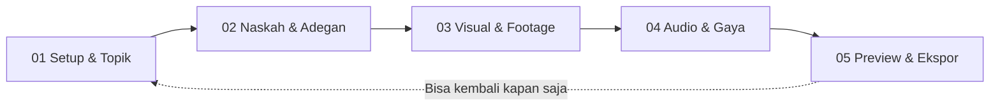

# Product Requirement Document (PRD): Redesain Studio Long-Form (Landscape 16:9)

**Versi Dokumen:** 1.0  
**Tanggal:** 28 September 2026  
**Target Rute:** `http://localhost:5173/studio`  
**Referensi Workflow:** `http://localhost:5173/shorts-studio`  
**Status:** Ready for Review / Implementation Plan  

---

## 1. Latar Belakang & Tujuan Redesain

Halaman `/studio` saat ini merupakan pusat produksi video YouTube Long-Form berorientasi landscape 16:9 berdurasi 3 hingga 10+ menit. Fitur di dalamnya sangat lengkap—mulai dari generator naskah AI, analisis struktur bab (chapter), library footage lokal dan Pexels, multi-mode voiceover (Edge TTS, F5-TTS, ElevenLabs, Mic/Upload), filter vokal FFmpeg DSP, manajemen BGM, hingga kostumisasi subtitle sinematik.

Namun, antarmuka saat ini menumpuk seluruh komponen dalam satu halaman dashboard panjang (*single overloaded view*):
* Script editor, banner voiceover, chip audio effect, slider BGM, timeline adegan, dan player 16:9 ditampilkan bersamaan.
* Pengguna sering merasa kewalahan (*cognitive overload*) karena tidak tahu langkah mana yang harus diselesaikan terlebih dahulu.

**Tujuan Redesain:**
Mengadopsi alur kerja berpanduan (*step-by-step guided stepper workflow*) yang telah terbukti sangat intuitif dan rapi pada `/shorts-studio`, **namun khusus disesuaikan untuk kebutuhan video YouTube Long-Form (Landscape 16:9)** serta **menjamin 100% fitur yang sudah ada tetap terjaga tanpa ada yang dikurangi sedikit pun**.

---

## 2. Prinsip Utama Desain (Design Principles)

1. **Zero Feature Regression (Tanpa Pengurangan Fitur):**
   Semua kemampuan teknis saat ini (Bab/Chaptering, 4 mode TTS, FFmpeg DSP Filter audition, BGM controller, Mic Recording, Upload Audio kustom, Pexels/Local Footage picker, Subtitle Customizer, dan Live Player 16:9) tetap ada dan terkelompokkan secara logis.
2. **Focused Cognitive Load (Satu Langkah Satu Fokus):**
   Pengguna mengerjakan video secara bertahap mulai dari ideasi topik ➔ penyusunan naskah per adegan ➔ kurasi footage visual ➔ pengaturan audio vokal & gaya subtitle ➔ preview final & render ekspor.
3. **Fluid Stepper Navigation:**
   Pengguna dapat berpindah antar-langkah (Step 1 s.d. 5) dengan bebas tanpa kehilangan progress, data naskah, atau cache audio.
4. **Cinematic 16:9 First-Class Experience:**
   Mempertahankan workstation preview 16:9 yang luas dan tajam dengan estetika dark mode premium (*glassmorphism*, status indicator, dan micro-animations).

---

## 3. Matriks Komparasi Workflow (Sebelum vs Sesudah)

| Aspek | Halaman `/studio` Saat Ini | Halaman `/studio` Baru (Ala Shorts Studio) |
| :--- | :--- | :--- |
| **Struktur Tampilan** | Dashboard 2 kolom bertumpuk satu halaman penuh. | Wizard Stepper 5 Tahap terstruktur rapi di bagian atas. |
| **Fokus Pengguna** | Semua kontrol bercampur (naskah, audio, BGM, footage, player). | Fokus per tahap: 1) Setup ➔ 2) Naskah ➔ 3) Footage ➔ 4) Audio & Gaya ➔ 5) Preview & Render. |
| **Navigasi** | Scroll atas-bawah tanpa pembagian babak yang jelas. | Tombol *Next Step* / *Previous Step* + Stepper dot bar interaktif. |
| **Review Audio & Subtitle** | Tersebar di banner atas dan modal terpisah. | Tahap khusus (Step 4) untuk mendengarkan karakter vokal, BGM, dan preset subtitle. |
| **Kesiapan Ekspor** | Tombol generate ada di tengah banner, terpisah dari player. | Tahap final (Step 5) menggabungkan player live 16:9, log console rendering, dan tombol ekspor video. |

---

## 4. Alur Kerja Baru 5 Langkah (The 5-Step Architecture)

---

### Step 01: Setup Topik & Ideasi Judul (`01 Setup & Topik`)
*Fokus: Menentukan fondasi konten, memilih sudut pandang pembahasan, dan judul video.*

* **Fitur yang Dipertahankan & Ditingkatkan:**
  1. **Pemilihan Preset Naskah Cepat:** Pilihan tema populer naskah panjang (Dokumenter Misteri, Sains & Alam, Filosofi Stoikisme, dll).
  2. **AI Topic Generator (DeepSeek):** Tombol membuka modal generator topik viral dengan formula hook kuat.
  3. **AI Title Generator (DeepSeek):** Rekomendasi 5 opsi judul klik-tinggi berbasis rasa ingin tahu (*curiosity gap*).
  4. **Input Judul Video:** Kolom judul kustom yang otomatis menjadi nama file `.mp4` hasil ekspor (dengan deteksi judul otomatis dari naskah).
  5. **Textarea Naskah / Draft:** Ruang menulis atau menempel (*paste*) draf narasi awal pengguna.
* **Tombol Aksi:**
  - `Lanjut ke Naskah (Step 2) ➔` (Melakukan parsing awal struktur naskah ke daftar adegan).

---

### Step 02: Editor Naskah & Struktur Bab (`02 Naskah & Adegan`)
*Fokus: Mematangkan pacing narasi, membagi naskah menjadi adegan terukur, dan mengatur chapter video.*

* **Fitur yang Dipertahankan & Ditingkatkan:**
  1. **Editor Naskah Utama (`ScriptEditor.svelte`):**
     - Dukungan sintaks bab video YouTube: format `[BAB 1: Judul Bab]`.
     - Penghitung kata, estimasi durasi total video (WPM).
     - Tombol *AI Refine Script* / *AI Expand Script* via DeepSeek modal.
  2. **Scene Breakdown View (Daftar Adegan):**
     - Kartu adegan berurutan dengan durasi estimasi per adegan.
     - Kemampuan menambah adegan baru (`+ Tambah Adegan`).
     - Pengaturan jeda antar bab (*chapter pause duration* dan *outro pause*).
     - Kalimat narasi yang bisa diedit langsung per kartu adegan.
* **Tombol Aksi:**
  - `⬅ Kembali ke Setup`
  - `Lanjut ke Pemilihan Footage (Step 3) ➔` (Menganalisis kata kunci visual per adegan).

---

### Step 03: Visual & Footage Bank (`03 Visual & Footage`)
*Fokus: Mengurasi latar belakang video per adegan agar relevan dengan narasi cerita.*

* **Fitur yang Dipertahankan & Ditingkatkan:**
  1. **Scene Visual Cards:**
     - Menampilkan thumbnail/video preview tiap adegan secara horizontal atau grid kartu.
     - Menampilkan prompt kata kunci visual (*visual query hint*, contoh: *"cinematic 4k technology, macro shot"*).
  2. **Pencarian & Penggantian Footage (`FootagePickerModal.svelte`):**
     - **Bank Footage Lokal:** Koleksi klip video offline di folder `static/footage/`.
     - **Pexels Video API:** Pencarian video HD/4K langsung dari Pexels gratis dengan query bahasa Inggris otomatis.
     - Indikator asal footage: badge `Lokal SSD` atau `Pexels Cloud`.
  3. **Auto-Match All Footages:** Tombol otomatis untuk mencocokkan video pada semua adegan secara instan berbasis AI tagging.
* **Tombol Aksi:**
  - `⬅ Kembali ke Naskah`
  - `Lanjut ke Pengaturan Audio & Gaya (Step 4) ➔`

---

### Step 04: Voiceover, Filter Vokal & Gaya Subtitle (`04 Audio & Gaya`)
*Fokus: Memoles elemen audio narator, backsound music, dan tipografi teks video.*

* **Fitur yang Dipertahankan & Ditingkatkan:**
  1. **Pilihan Provider Voiceover (4 Mode Utama):**
     - **🌐 Edge TTS (Gratis 100%):** Suara `id-ID-ArdiNeural` (Pria), `id-ID-GadisNeural` (Wanita), serta daftar suara internasional lengkap.
     - **⚡ F5-TTS Lokal (M1/Apple Silicon):** Suara alami zero-cost yang diproses melalui server lokal.
     - **🤖 ElevenLabs AI (Premium):** Suara flagship (Adam, Sarah, Liam, George, dsb) dengan pilihan model `Eleven Multilingual v2`, `Turbo v2.5`, atau `Flash v2.5`.
     - **🎧 Rekaman Sendiri (Mic / Upload File):**
       - Rekam suara langsung via browser per adegan (`handleRecordAudio`).
       - Upload audio rekaman eksternal individual atau batch (`handleUploadAudio`, `handleBatchUploadAudio`).
       - Sinkronisasi deteksi jeda ucapan otomatis (*speech boundaries*).
  2. **Filter Karakter Vokal FFmpeg (DSP Presets):**
     - Preset: *Studio Podcast*, *Radio Warmth*, *Cinema Epic Bass*, *Crystal Clear*, *Deep Narrator*, *Telephone Vintage*.
     - Tombol audisi audio (*Play preview sound sample* `▶`/`⏹`) untuk mendengarkan efek filter secara langsung sebelum diterapkan.
     - Tombol *Terapkan ke Semua Adegan* atau atur custom per adegan.
  3. **Pengaturan Background Music (BGM Engine):**
     - Pilihan track: *Documentary Suspense*, *Ambient*, *Lofi Chill*, *Inspiring*, *None*.
     - Live preview tombol play/stop musik latar.
     - Slider volume BGM + quick presets (*Mute 0%*, *Halus 5%*, *Sedang 10%*, *Tegas 18%*).
  4. **Kustomisasi Subtitle & Animasi Teks (`SubtitleStyleModal.svelte`):**
     - Gaya: *Cinema Essay*, *Documentary Clean*, *Modern Bold*, *Viral Pop*.
     - Mode animasi: *Word-by-word*, *Fade in*, *Karaoke Highlight*.
     - Posisi subtitle: *Cinema Split (atas/bawah)*, *Bottom Center*, *Middle*.
     - Pengaturan ukuran font (*font size*) dan jumlah kata per baris (*words per line*).
* **Tombol Aksi:**
  - `⬅ Kembali ke Footage`
  - `Generate Voiceover & Buka Studio Player (Step 5) ➔`

---

### Step 05: Live Studio Player, Storyboard & Render Video (`05 Preview & Ekspor`)
*Fokus: Memeriksa hasil rakitan video secara utuh dan mengekspor file video final.*

* **Fitur yang Dipertahankan & Ditingkatkan:**
  1. **Live Studio Player 16:9 (`StudioPlayer.svelte`):**
     - Preview canvas landscape widescreen 16:9.
     - Sinkronisasi audio voiceover, backsound musik, dan animasi teks subtitle karaoke secara real-time.
     - Kontrol player: Play/Pause, Timeline Scrubber, Durasi Berjalan, Toggle Fullscreen.
  2. **Interactive Storyboard Timeline (`SceneTimeline.svelte`):**
     - Timeline adegan di bawah player untuk melompat antar adegan, mengganti rekaman suara adegan tertentu, fine-tuning offset waktu narasi (*timing offset*), dan review durasi per clip.
  3. **Generation Progress Console (`GenerationProgressConsole.svelte`):**
     - Terminal monitor proses backend: log pembuatan TTS, status caching audio disk, unduhan klip, dan estimasi waktu.
  4. **Render & Export Manager (`ExportModal.svelte`):**
     - Pemilihan resolusi render: 1080p Full HD (Landscape 16:9).
     - Pilihan preset hardware encoder (misal: *Apple VideoToolbox h264_videotoolbox* untuk Mac M-Series atau *libx264*).
     - Progress bar render persentase 0–100%.
     - Tombol *Download MP4* setelah render selesai dengan penamaan file rapi sesuai judul video.
* **Tombol Aksi:**
  - `⬅ Kembali & Edit Audio/Footage`
  - `🚀 Render & Download Video Final (MP4)`

---

## 5. Spesifikasi Antarmuka & UX (UI/UX Specification)

### A. Header & Stepper Bar (Sticky Top)
Komponen navigasi wizard diletakkan di bagian atas halaman:
* **Indikator Titik (Dots):** 5 langkah berurutan dengan ikon check `✓` jika sudah selesai.
* **Label Stepper:**
  - `01 Setup` ➔ `02 Naskah` ➔ `03 Footage` ➔ `04 Audio & Gaya` ➔ `05 Preview & Ekspor`
* **Status Badges:** Menampilkan judul video aktif, estimasi durasi total, dan jumlah adegan di sebelah kanan navbar.

### B. Layout Content Area
* Menggunakan container responsif terpusat (*max-width: 1280px*) dengan padding optimal.
* Desain kartu bertema gelap (*Dark Studio Palette*):
  - Background utama: `#0B0F19` (Deep Navy Black).
  - Surface Card: `rgba(255, 255, 255, 0.03)` dengan border halus `rgba(255, 255, 255, 0.08)`.
  - Aksen Aktif / CTA: Biru Neon / Indigo Elektrik (`#3B82F6` & `#6366F1`) untuk primary action, dan Aksen Emerald (`#10B981`) untuk status sukses / voice ready.

### C. State Persistence (Penyimpanan Status Lokal)
Semua input dan preferensi pengguna otomatis tersimpan ke `localStorage`:
* API Keys (DeepSeek, ElevenLabs, Pexels).
* Pemilihan Voice ID & Provider (`voiceMode`, `selectedVoiceId`).
* Audio Effect Preset (`selectedAudioEffect`).
* Gaya Subtitle, Posisi, dan Ukuran Font (`subtitleStyleKey`, `subtitleFontSize`, dll).
* Draft naskah dan daftar adegan yang telah diolah, sehingga jika browser direfresh, pengguna tidak perlu mengulang dari awal.

---

## 6. Daftar Komponen & Pemetaan File (Component Architecture)

Seluruh komponen pendukung yang sudah ada akan tetap dimanfaatkan tanpa perlu membuat ulang dari nol:

| File Komponen | Peran dalam Alur Baru | Penempatan di Step |
| :--- | :--- | :--- |
| `src/routes/studio/+page.svelte` | Orkestrator Utama (mengatur state `step = 1..5`, data pipeline, dan event handler). | Halaman Utama |
| `ScriptEditor.svelte` | Input teks naskah, word counter, chapter tags parser. | Step 1 & Step 2 |
| `TopicGeneratorModal.svelte` | Modal pembuat topik & ide video berbasis AI. | Step 1 |
| `TitleGeneratorModal.svelte` | Modal pembuat judul viral berbasis hook. | Step 1 |
| `ScriptGeneratorModal.svelte` | Modal pembuatan draft naskah full berbasis AI. | Step 1 & Step 2 |
| `FootagePickerModal.svelte` | Modal pemilih footage lokal SSD & Pexels. | Step 3 |
| `SubtitleStyleModal.svelte` | Modal kustomisasi gaya tipografi dan animasi subtitle. | Step 4 |
| `SettingsModal.svelte` | Modal pengaturan API keys & diagnosa sistem audio. | Header / Akses Global |
| `StudioPlayer.svelte` | Pemutar video sinematik 16:9 interaktif dengan sinkronisasi karaoke. | Step 5 |
| `SceneTimeline.svelte` | Storyboard visual per adegan, kontrol fine-tuning, dan upload mic. | Step 5 (di bawah Player) & Step 3 |
| `GenerationProgressConsole.svelte` | Terminal live streaming log pemrosesan pipeline audio/video. | Step 4 & Step 5 |
| `ExportModal.svelte` | Dialog progress rendering video FFmpeg dan link unduh MP4. | Step 5 |

---

## 7. Checklist Verifikasi & Jaminan Fitur (Quality Assurance)

Sebelum rilis, pengujian harus memvalidasi bahwa tidak ada fungsionalitas yang hilang:

- [ ] **Struktur Bab (`[BAB ...]`)**: Tetap dikenali dengan benar dan memicu intro audio jeda bab.
- [ ] **Mode Suara Edge TTS**: Berjalan normal tanpa API key, subtitle tersinkronisasi presisi kata-per-kata.
- [ ] **Mode Suara ElevenLabs**: Model v2 / turbo berjalan dengan API key pengguna, jika kuota habis fallback mulus ke Edge TTS.
- [ ] **Mode Rekaman Sendiri / Mic**: Pengguna tetap bisa merekam suara langsung per adegan atau mengunggah file `.mp3`/`.wav`.
- [ ] **FFmpeg Vocal Filter DSP**: Sampel audio bisa didengarkan (*audition*), dan efek berhasil diaplikasikan saat menyimpan audio server.
- [ ] **BGM Music Engine**: Backsound bisa diputar preview, volume slider bekerja, dan ducking suara berfungsi baik.
- [ ] **Footage Selector**: Pengguna bisa mencari video lokal dan Pexels per adegan.
- [ ] **Live Player 16:9**: Video, suara, BGM, dan subtitle berputar serentak dan mulus.
- [ ] **Navigasi Stepper**: Pengguna bisa bolak-balik antara Step 1 sampai Step 5 tanpa kehilangan adegan yang sudah diisi atau di-generate.
- [ ] **Ekspor Video**: Render video 16:9 1080p menghasilkan output MP4 jernih dengan audio dan subtitle yang selaras.

---

## 8. Rekomendasi Tahap Implementasi Selanjutnya

1. **Review & Approval PRD:** Konfirmasi bahwa pembagian 5 langkah dan penempatan fitur sudah sesuai dengan visi pengguna.
2. **Refactoring `src/routes/studio/+page.svelte`:**
   - Menambahkan state `let step = $state(1)`.
   - Mengelompokkan UI template ke dalam blok `{#if step === 1}`, `{#if step === 2}`, `{#if step === 3}`, `{#if step === 4}`, dan `{#if step === 5}`.
   - Menambahkan bar stepper navigasi di atas dan tombol *Kembali / Lanjut* di setiap langkah.
3. **Uji Coba Interaktif:** Menjalankan alur lengkap dari pembuatan naskah hingga render di browser untuk memastikan kenyamanan pengguna.
